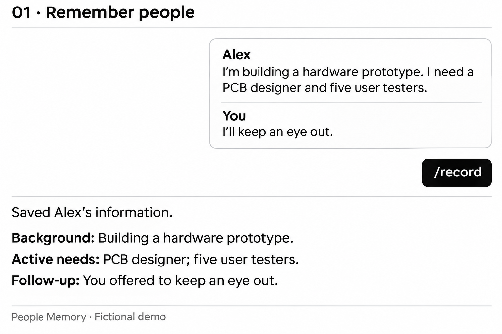
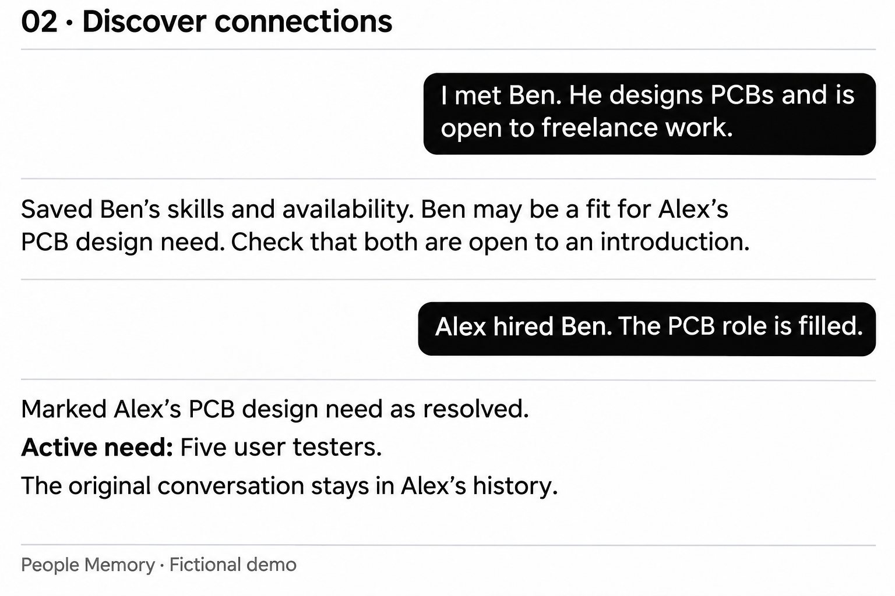
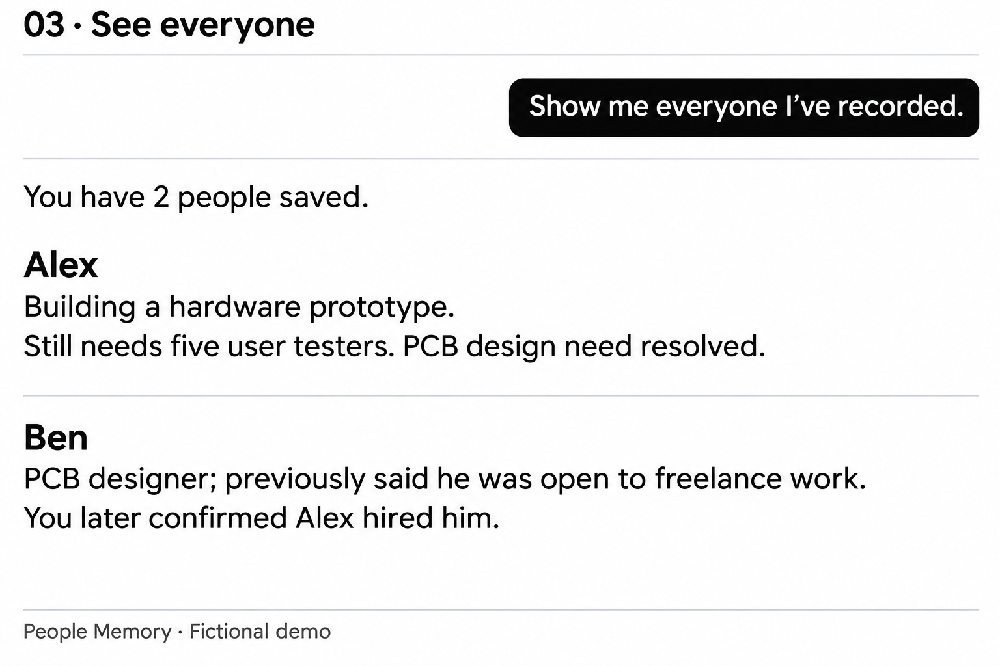
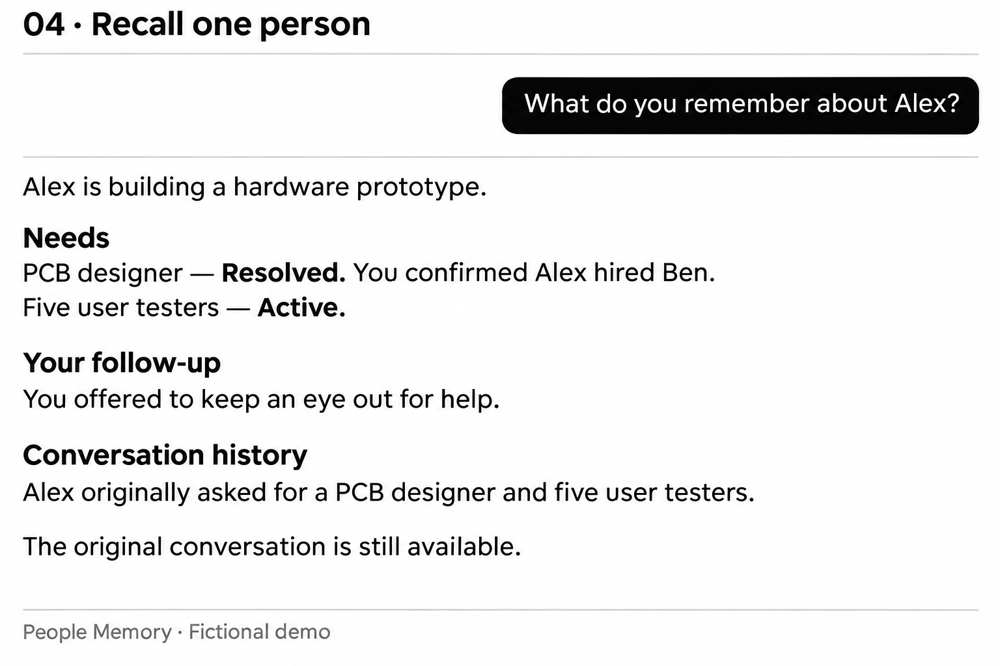
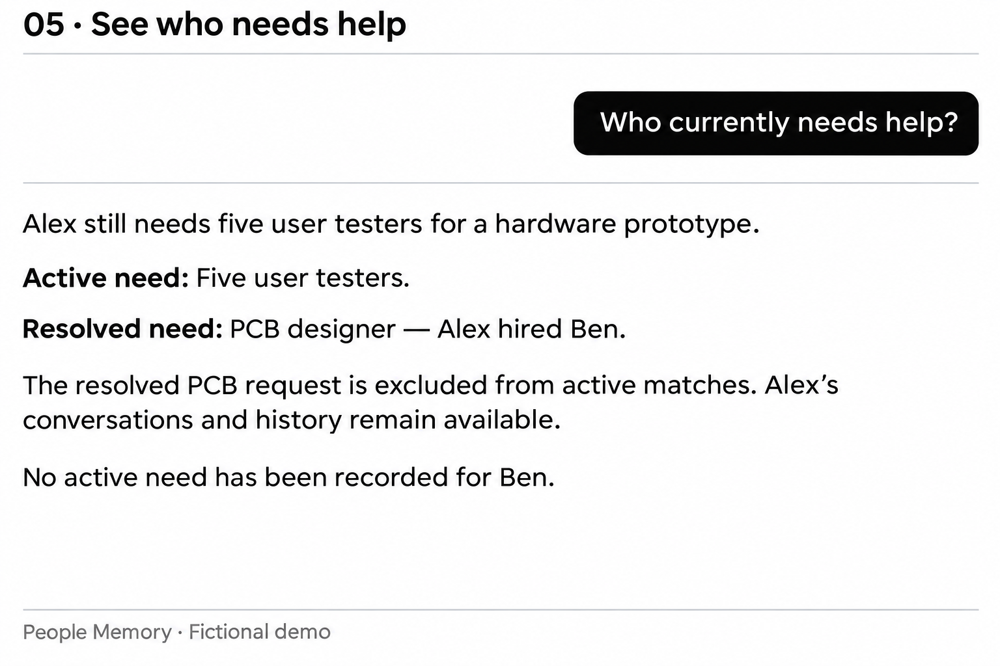

# People Memory

People Memory gives your AI assistant a lasting memory of the people you know: what they’re working on, what they need, what they can offer, and your past conversations. Share updates naturally in chat. Your assistant can save the details, recall them later, and surface relevant connections when you mention a new person, resource, or opportunity—without you having to remember who needed what.

[How it works](#how-it-works) · [Getting started](#getting-started)

## How it works

Simple and intuitive. These conceptual chat demos use fictional people and follow one story from recording to retrieval.

### 📝 Remember people

Use `/record` and share a conversation, screenshot, or notes. Your assistant extracts the relevant details.



You can also share information naturally—automatic recording is on by default.

### 🔗 Discover connections

Mention someone new, and your assistant can connect their skills to a saved need. Later updates resolve each need separately while preserving the original conversation.



### 🔎 Retrieve people’s information

Ask in everyday language.

**See everyone you’ve recorded**

> “Show me everyone I’ve recorded.”



**Recall a specific person**

> “What do you remember about Alex?”



**See who currently needs help**

> “Who currently needs help?”



## Getting started

You’ll need Python 3.10+ and an AI app that supports local MCP servers.

### Set up with an AI assistant

Paste this into an AI coding assistant that can run commands and edit files on your computer:

> Install People Memory from https://github.com/MattChenyuanZhang/people-memory. Follow its manual setup and connection guide for my AI app, preserving existing settings. Check that the bundled memory and Record skills were installed for my app, tell me where my database is stored, and verify saving and retrieving a fictional person. If a step needs me to act in the app, tell me what to do.

### Install manually

<details>
<summary>Open the step-by-step instructions</summary>

#### 1. Check the requirements

- Python 3.10 or newer, with SQLite FTS5 support.
- An AI app that supports **local MCP servers**—a way for the assistant to call tools on your computer.
- Access to that app's MCP settings and persistent assistant instructions.

People Memory doesn't need its own model API key. Your chosen assistant may require an account, subscription, or API access.

#### 2. Download

Download and extract the [latest source ZIP](https://github.com/MattChenyuanZhang/people-memory/archive/refs/heads/main.zip), or clone:

```sh
git clone https://github.com/MattChenyuanZhang/people-memory.git
cd people-memory
```

Open a terminal in the extracted/cloned folder. Keep it in a permanent location so your app's connection path won't break later.

#### 3. Install and create your database

**macOS / Linux:**

```sh
python3 -m venv .venv
.venv/bin/python -m pip install '.[mcp]'
.venv/bin/people-match init
```

**Windows PowerShell:**

```powershell
py -m venv .venv
.\.venv\Scripts\python.exe -m pip install ".[mcp]"
.\.venv\Scripts\people-match.exe init
```

`init` creates your personal database outside the repository and prints its location. It also installs the bundled memory and `/record` skills when it detects Codex or Claude Code. Existing custom skills are preserved; any skipped installations are reported. Restart your app if the skills do not appear. To share memory across AI apps, use that same database in each connection. Do not upload it to GitHub.

The package and command currently retain their original names, `people-match-memory` and `people-match`. The repository is called People Memory. Install from this download; the package isn't published on PyPI.

#### 4. Connect your AI app

Follow the [connection guide](docs/connecting.md) for your app. Register a **local stdio MCP server** with:

- **Command:** the absolute path to `.venv/bin/people-match`, or `.venv\Scripts\people-match.exe` on Windows.
- **Arguments:** `serve`.

Your app starts this process when it needs the tools. You don't need to leave a manually launched server running in a terminal.

#### 5. Load the memory instructions

Display the bundled instructions:

```sh
# macOS / Linux
.venv/bin/people-match instructions
```

```powershell
# Windows PowerShell
.\.venv\Scripts\people-match.exe instructions
```

If `init` reported the skills as installed for your app, this step is already handled. Otherwise, add the output to your assistant's persistent project instructions, preserving any instructions already there. If your app supports agent skills, you can install the included [people-memory skill](skills/people-memory/SKILL.md) instead. Check the connection guide for details.

**The connection provides the tools; the instructions explain when to record and retrieve.** Each app/project you use needs the appropriate setup.

#### 6. Verify before using real information

In a new connected chat:

1. Ask: “Use People Memory to show whether automatic recording is enabled.”
2. Say: “Please explicitly save this fictional test person: Riley Example needs a PCB designer.” Check for a successful save confirmation and change ID.
3. In a fresh chat, ask: “Search my memory: what does Riley Example need?” Check that the saved need and evidence are retrieved.

Then follow the [full first-use check](docs/connecting.md#4-check-it-with-fictional-information) to test updates, pause, exclusions, and cross-app recall. You're ready to try the natural-language workflows above when these checks work in your app.

</details>

For app-specific setup and troubleshooting, see the [connection guide](docs/connecting.md).

### Further details

- [Connection examples and troubleshooting](docs/connecting.md)
- [Backups, export, CLI commands, privacy, deletion, and prototype import](docs/reference.md)
- [Architecture](docs/architecture.md) and [record formats](docs/data-format.md)
- [Automated test results](https://github.com/MattChenyuanZhang/people-memory/actions/runs/42135951604): 17 tests and package builds passed on macOS, Windows, and Linux with Python 3.10 and 3.12. These test the software and MCP protocol, not actual model behavior.

[MIT license](LICENSE). Always free.
